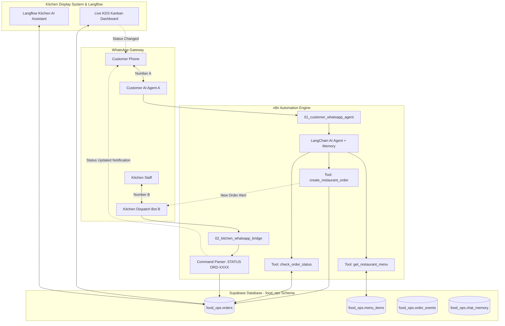

# 🍔 Autonomous Dual-WhatsApp Restaurant Agent & Kitchen Display System (KDS)

[](https://n8n.io)
[](https://supabase.com)
[](https://developers.facebook.com/docs/whatsapp)
[](https://langflow.org)
[](https://tailwindcss.com)

An end-to-end autonomous food ordering and kitchen dispatch system engineered with **n8n**, **Supabase**, and **Langflow**. The system orchestrates communication across **two separate WhatsApp phone numbers**:
1. **Business Number A (Customer Facing)**: An autonomous AI agent takes orders, answers menu inquiries, validates delivery addresses, computes bills, confirms orders, and tracks real-time progress.
2. **Business Number B (Kitchen Dispatch & Staff)**: Receives instant order alerts, allows kitchen staff to update preparation statuses directly via WhatsApp quick replies, and synchronizes with a live **Kitchen Display System (KDS)**.

---

## 🏗️ System Architecture



---

## ✨ Key Technical Highlights

1. **Dual-Number WhatsApp Architecture**:
   - Customer conversation strictly separated on Number A.
   - Kitchen dispatch and alerts strictly on Number B.
   - Any status change in Kitchen immediately alerts Customer on Number A.

2. **Zero-Conflict Supabase Schema (`food_ops`)**:
   - Runs in a clean, isolated database schema `food_ops`.
   - Never touches or conflicts with existing tables in your Supabase project.
   - Complete ACID compliance with stored procedure `food_ops.update_order_status()` and atomic audit logs.

3. **Production n8n Workflows**:
   - Universal payload normalizer supporting **Meta WhatsApp Cloud API**, **Evolution API**, **Z-API**, and local simulators.
   - Webhook verification challenge handler (`hub.challenge`) for Meta developer requirements.
   - LangChain conversational agent with window buffer memory keyed to customer phone number.
   - Strict tool execution: Order is only placed when customer provides explicit confirmation of items and address.

4. **Live Kitchen Display System (KDS)**:
   - Modern, high-contrast dark theme designed for fast kitchen environments.
   - Kanban board categorized into **Received**, **Cooking Prep**, **Out with Rider**, and **Delivered**.
   - Built-in audio chime (using Web Audio API synthesizer) that rings like a real restaurant bell when an order arrives.
   - Real-time live timers with color-coded urgency (warning at > 25 mins).
   - Instant "Simulate Order" button for recording portfolio demos.

5. **WhatsApp Simulator Tool**:
   - Interactive split-screen phone mockup to demo the entire flow side-by-side in your browser without requiring live Meta developer setup.

---

## 📂 Repository Structure

```
whatsapp-restaurant-agent/
├── README.md                      # Complete Project Documentation & Architecture
├── supabase/
│   ├── 01_schema.sql              # Clean isolated schema `food_ops` (Orders, Menu, Triggers, RPC)
│   └── 02_seed_data.sql           # 15+ delicious menu items, categories, and realistic seed orders
├── n8n/
│   ├── 01_customer_whatsapp_agent.json   # Customer Facing AI Agent (WhatsApp A)
│   ├── 02_kitchen_whatsapp_bridge.json   # Kitchen Staff Command Responder (WhatsApp B)
│   ├── 03_dashboard_api_bridge.json      # REST API bridge for KDS Dashboard & Webhooks
│   └── n8n_setup_guide.md                # Credentials, environment variables & node mapping
├── dashboard/
│   ├── index.html                 # Live Kitchen Display System (KDS) UI
│   ├── app.js                     # Real-time state manager, audio chime & Supabase client
│   └── styles.css                 # Custom scrollbars, glow effects & card transitions
├── simulator/
│   └── index.html                 # Dual WhatsApp Phone Mockup for live portfolio presentation
├── whatsapp-mockup/
│   └── index.html                 # 🌟 Pixel-Perfect Authentic WhatsApp Mobile/Desktop UI for Portfolio Screenshots
├── upwork/
│   ├── banner_4x3_template.html   # 4:3 Ratio Template for Upwork Project Catalog
│   └── banner_4x3_animated.html   # Animated 4:3 Showcase Template
├── upwork_catalog_cover_1200x900.png # 🖼️ Official Upwork 4:3 Project Catalog Cover Image (1200x900)
├── upwork_catalog_cover_4x3.png      # 🖼️ High-Res 4:3 Project Catalog Cover Image (1600x1200)
├── upwork_catalog_video_4x3.mp4      # 🎬 Official Upwork 4:3 Project Catalog Showcase Video (1200x900)
├── whatsapp_chat_demo.mp4            # 🎬 Mobile Portrait (9:16) Video for Reels / Shorts / Direct Demos
└── langflow/
    ├── kitchen_agent_prompt.txt   # Fine-tuned System Prompt for Langflow Agent
    └── langflow_flow_guide.md     # Custom Python components & wiring guide
```

---

## 🚀 Quickstart Walkthrough

### Step 1: Database Setup (1 Minute)
1. Open your [Supabase Dashboard](https://supabase.com).
2. Go to **SQL Editor** -> **New Query**.
3. Paste the contents of `supabase/01_schema.sql` and click **Run**.
4. Paste the contents of `supabase/02_seed_data.sql` and click **Run**.
5. Your isolated `food_ops` schema is now fully primed with menu items and test orders!

### Step 2: Live Kitchen Dashboard
1. Simply double-click or open `dashboard/index.html` in any web browser.
2. The dashboard will load with live demo orders.
3. Click **"Simulate WhatsApp Order"** in the top right:
   - Notice the realistic restaurant bell chime sound!
   - A new order `ORD-XXXX` appears in the **New Received** column.
   - Click **"Start Prep"** to move it to **Kitchen Prep**.
   - Click **"Dispatch to Rider"** to move it to **Out with Rider**.
4. *(Optional)* Click the **Settings Gear Icon** to enter your Supabase URL & Anon Key for real-time cloud sync.

### Step 3: Run the Phone Simulator
1. Open `simulator/index.html` in your browser.
2. Left side: Chat as a customer on WhatsApp Number A:
   - Click **"📋 Menu dikhao"** to see food items.
   - Type `"Mujhe 2 Zinger burger order karni hain"`.
   - Provide address: `"House 12, Street 4, Sector F-8, Islamabad"`.
   - Type `"Haan confirm kar do"`.
3. Right side: Watch the Kitchen Terminal on Number B instantly receive:
   `🚨 NEW ORDER RECEIVED: ORD-XXXX...`
4. Reply on Number B with `STATUS ORD-XXXX PREPARING` and watch Customer A get notified immediately!

### Step 4: Import into n8n
1. Open your n8n canvas.
2. Click **Workflows** -> **Import from File**.
3. Select `n8n/01_customer_whatsapp_agent.json` and `n8n/02_kitchen_whatsapp_bridge.json`.
4. Connect your OpenAI API Key and PostgreSQL (Supabase) credential.
5. Activate the workflows!

---

## 🎥 Portfolio Demo Video Script (How to Present)

When presenting this project to a client, on LinkedIn, or in a portfolio interview:

1. **The Problem**: *"Traditional restaurant ordering is fragmented. Staff misread order items, customers repeatedly call asking 'where is my food?', and kitchens struggle to coordinate between delivery drivers and food prep."*
2. **The Solution**: *"I built an autonomous dual-number WhatsApp architecture. Customer WhatsApp A runs a conversational LLM agent that acts as an expert concierge, takes orders in USD ($), checks menu availability, and collects structured US street addresses."*
3. **The Kitchen Hand-off**: *"Once confirmed, the order instantly routes to WhatsApp Number B in the kitchen and renders on a real-time Kitchen Display System (KDS) with audio alert chimes."*
4. **Real-time Feedback Loop**: *"When the chef marks the food as 'Out for Delivery', the customer automatically receives a proactive WhatsApp notification on Number A without any manual typing needed from the staff."*
5. **Technical Stack**: *"n8n orchestration, Supabase PostgreSQL with isolated schemas and RLS, LangChain tool calling, and responsive Tailwind UI."*
